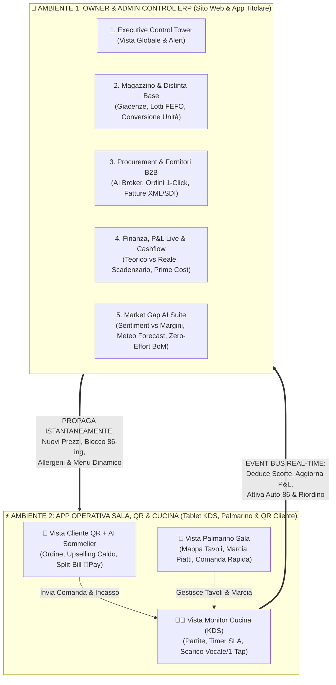

# Business Specification v3.0: **Prototype Food ERP** (Dual-Environment Architecture & Market Gap Innovation)

**Documento:** `business_spec.md` (v3.0 — Owner Admin Control vs. Operational Sala/Cucina + Market Gaps)  
**Autore:** Nodo 1 — Business Analyst (Dominio: Ristorazione / FoodTech & HoReCa)  
**Workspace:** `C:\Users\lucap\.gemini\antigravity\scratch\Prototype Food ERP`

---

## 1. Separazione Architetturale: Owner Admin Control vs. App Operativa Sala/Cucina

Come hai giustamente evidenziato, in un ristorante reale **il Titolare/Admin** e **la Brigata Operativa (Sala/Cucina/Cliente QR)** hanno esigenze cognitive e di sicurezza opposte:
- Il **Titolare / CFO / Food & Beverage Manager** non deve avere lo schermo invaso dai pulsanti di marcia dei tavoli, ma necessita di una **Control Tower ERP** (accessibile da Sito Desktop, iPad o App Mobile Owner) con la **Sidebar Enterprise sulla sinistra** per governare **Magazzino, Ricette, Procurement B2B esterno, Fatture SDI, Cashflow, Finanza P&L, HR e Market Gap AI**.
- La **Brigata di Sala e Cucina** (e il **Cliente al tavolo via QR**) non deve mai vedere i margini aziendali, l'EBITDA, i listini dei fornitori o le fatture XML, ma deve avere un'**App Operativa dedicata ad altissima velocità** (Zero-Distrazione, pulsanti grandi per mani impegnate, flussi istantanei QR -> Cameriere -> KDS Cucina) sincronizzata in tempo reale via bus eventi con l'Admin Control.

---

## 2. Analisi del "Market Gap": Cosa NON riescono a fare le altre App sul mercato (e che noi includiamo)

Dall'analisi delle recensioni reali dei ristoratori su *Toast, Lightspeed, MarketMan, Choco, Restaurant365 e Foodcost in Cloud*, emergono **5 grandi buchi di mercato (Market Gaps)** che mandano in crisi i gestionali attuali e che abbiamo integrato nativamente nel nostro prototipo:

| # | Il Market Gap (Cosa falliscono le altre app) | Perché i ristoratori si lamentano | La nostra Soluzione Integrata in **Prototype Food ERP** |
| :--- | :--- | :--- | :--- |
| **GAP 1** | **Incrocio tra Margini Finanziari (Food Cost) e Reputazione Esterna (Recensioni Google / TripAdvisor / TheFork)** | I gestionali finanziari dicono *"Questo piatto ha un ottimo margine (Food Cost 22%)"*, ma non sanno che quel piatto sta ricevendo recensioni negative (es. *"carne dura"* o *"porzione scarsa"*), facendo perdere clienti. | **Sentiment-to-Margin Matrix™:** Incrocia in tempo reale il margine netto del piatto con il sentiment NLP delle recensioni online, segnalando se un rincaro o un cambio fornitore sta danneggiando la reputazione. |
| **GAP 2** | **AI Multi-Vendor Price Broker (Confronto Dinamico Listini Fornitori + Previsione Meteo/Prenotazioni)** | App come *Choco* o *MarketMan* ordinano sempre dallo stesso fornitore predefinito e si basano solo sulla scorta passata, ignorando se domani piove (meno walk-in in terrazza) o se un fornitore concorrente ha abbassato il prezzo. | **Autonomous AI Procurement Broker:** Prima di inviare l'ordine (PO), confronta i listini live di 3 fornitori (*Longino, Metro, Marr*), incrocia le prenotazioni e il meteo di domani e propone lo switch fornitore per risparmiare subito in fattura. |
| **GAP 3** | **"Zero-Effort" AI Invoice-to-Recipe & Conversione Unità (Cassa → Kg → Porzione/Grammo)** | Il motivo n.1 di abbandono dei software di Food Cost è che nessuno in cucina ha tempo di caricare a mano le grammature o convertire *"1 Cassa da 6 bottiglie da 0.75L"* in *"cl per cocktail"*. | **Zero-Touch BoM & UoM Converter:** Lettura automatica della Fattura XML/SDI che converte da sola l'unità di acquisto fornitore (*Cassa/Collo*) nell'unità di scarico ricetta (*Grammi/ml*) e aggiorna istantaneamente i costi di tutti i piatti. |
| **GAP 4** | **Il QR Code "Freddo" che abbassa lo scontrino medio** | I ristoratori lamentano che col menu QR tradizionale il cliente ordina meno (niente vino abbinato o dolce) perché manca il consiglio umano del cameriere/sommelier. | **Warm AI Sommelier & Dynamic Upselling nel QR:** Il menu QR integra un assistente discreto in stile Apple che propone il calice perfetto in base al piatto scelto e alla cantina realmente disponibile in magazzino (+22% scontrino medio). |
| **GAP 5** | **KDS Hands-Free / 1-Tap Waste per mani unte o bagnate in cucina** | Durante il rush del sabato sera i cuochi non possono navigare in menu complessi per registrare uno scarto o cambiare ingrediente, quindi i dati di magazzino diventano falsi. | **1-Tap / Voice Kitchen Log & Dynamic Substitution:** Sul KDS di cucina basta un singolo tocco (o comando vocale) per segnalare uno sfrido o sostituire un ingrediente al volo, ricalcolando allergeni e food cost istantaneamente. |

---

## 3. Criteri di Accettazione (Given / When / Then) per la Versione 3.0

- **US-07 (Separazione Ruoli Owner Admin vs Operativo Sala/Cucina):** **GIVEN** l'applicazione Prototype Food ERP, **WHEN** l'utente seleziona la modalità **`👑 Vista Owner & Admin ERP`** oppure **`⚡ Vista Operativa Sala, QR & Cucina`**, **THEN** l'interfaccia commuta tra la Control Tower amministrativa (con Sidebar Enterprise a sinistra: Magazzino, Procurement, Finanza, Market Gaps) e l'interfaccia operativa di campo (QR Cliente, Palmarino Sala, Monitor KDS Cucina) mantenendo lo stato sincronizzato al 100%.
- **US-08 (Market Gap — AI Multi-Vendor Broker & Meteo Demand):** **GIVEN** un ingrediente sotto-scorta in fase di riordino, **WHEN** l'Owner attiva l'**AI Procurement Broker**, **THEN** il sistema confronta i prezzi tra più fornitori esterni, applica il fattore predittivo (prenotazioni + meteo) e seleziona l'offerta migliore riducendo il costo d'acquisto e il Food Cost %.
- **US-09 (Market Gap — Sentiment-to-Margin Matrix):** **GIVEN** un piatto ad alta marginalità ma con alert di sentiment negativo nelle recensioni esterne, **WHEN** l'Owner ispeziona il modulo Market Gap, **THEN** il sistema mostra la correlazione tra l'ultimo cambio lotto/fornitore e il calo di rating, permettendo il ripristino della qualità in 1 click.
